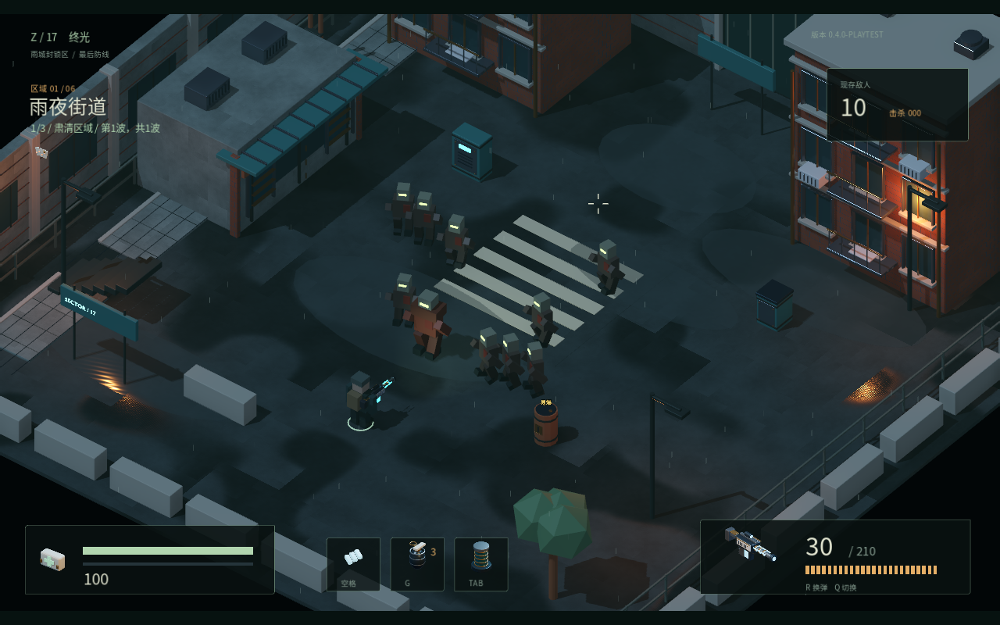
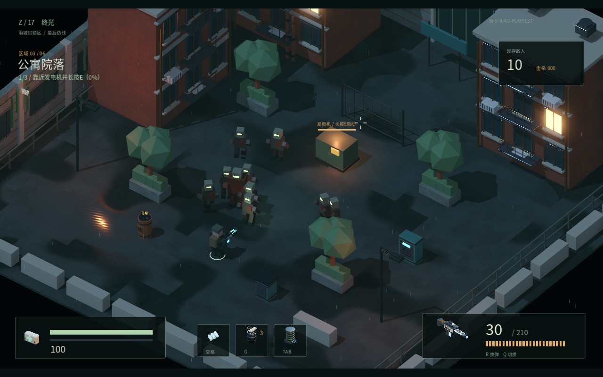
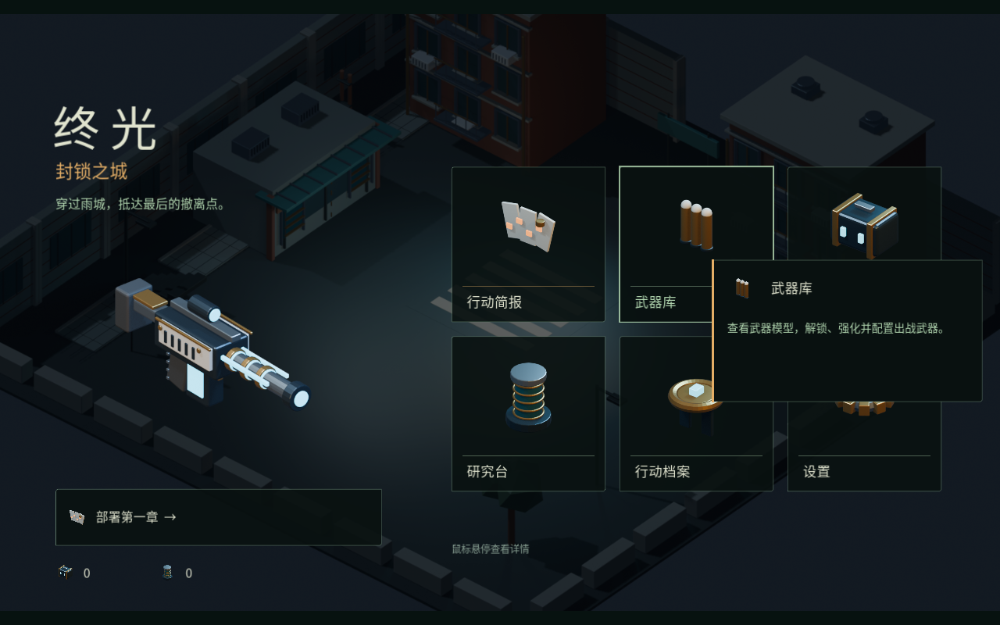

# 终光 / ZOMBIED — Last Light

个人游戏作品 · 游戏策划 / 关卡与场景设计 · Godot 3D 斜俯视尸潮 Roguelite 原型。

以章节推进、局内构筑和局外养成为体验主线。此项目借助 AI 工具辅助制作与实现；展示重点是玩法组织、空间设计、场景建模与可玩的交互验证。

## 试玩下载

在 [Releases](https://github.com/5612651/Zombied-Last-Light/releases) 下载 **Zombied_Chapter01_Playtest_v5.zip**，完整解压后运行 `Zombied.exe`。保持 EXE 与 PCK 在同一目录，不需要安装 Godot 或 Blender。当前版本 **0.4.0-playtest / v5**，属于开发阶段预发布试玩。

WASD 移动 / 鼠标瞄准 / 左键开火 / R 换弹 / Q 切枪 / 空格冲刺 / G 手雷 / E 发电机交互 / TAB 构筑 / ESC 暂停。安全屋按回车部署第一章。`Weapon Lab.cmd` 提供六枪试射。

## 设计重点

- **章节节奏**：雨夜街道 → 商业区 → 公寓院落 → 地下停车场 → 加油站 → 撤离 Boss，六个区域形成一次 Run。
- **目标与成长**：战斗/目标 → 结算奖励 → 强化三选一 → 开门进入下一区域；失败回基地，局内构筑清空，已结算永久资料保留。
- **构筑选择**：六类 30 项强化、六种武器与武器进化；局外战斗数值收益限制在基础强度的 +30%，让局内选择承担主要变化。
- **空间与氛围**：Blender 模块化街区、建筑与场景道具；用围合空间、入口、掩体与冷暖灯光组织斜俯视战斗。
- **信息与反馈**：中文安全屋、武器预览、强化卡和构筑图标；分层命中效果、方向后坐和可调屏幕效果。

## 源项目

使用 Godot 4.7.2 导入 `project.godot`。运行资源、场景、GDScript、着色器、数据、测试及 Blender 源文件在本仓库；缓存、工具插件克隆、参考视频、开发日志和试玩二进制不入库。`docs/` 保留核心规则、章节、反馈与模块化设计资料。

当前 56 个源码清单文件已与 v5 分发包 `source-manifest.json` 逐项核对一致。完整运行资源以实际 Godot 导入和构建为准；本次上传没有重新构建二进制。

## 验证范围

v5 ZIP CRC 检查、SHA-256 核对，以及已有分发截图和包验证记录可见 `evidence/`。九张实际分发画面为开发捕获场景，不等于完整正常关卡通关。**v5 真实时间整章完成、5–10 位外部玩家反馈和普通电脑性能验收尚未完成**；v4 的整章结果不归属于 v5，不宣称稳定 60 FPS 或最终 Steam Demo。

ZIP SHA-256：`3fba5254a48cb12984db25b35a540d3c0bb27c1339dbbd1df578cfe4af14c8e8`。

## 资源与授权

字体授权见 `assets/fonts/OFL.txt`。Godot/Jolt 等引擎版权说明随试玩包分发。本仓库作为个人作品展示，未额外授予项目代码、美术或其他资产的再分发许可；第三方授权以其随附文本为准。
